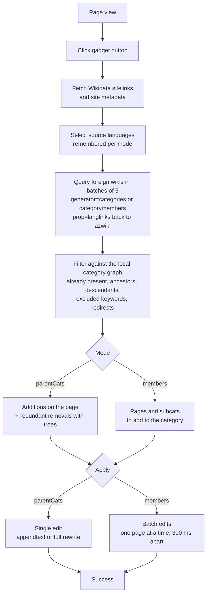
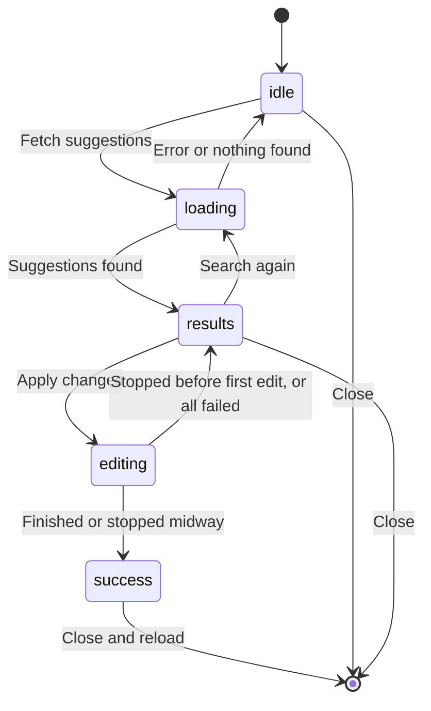
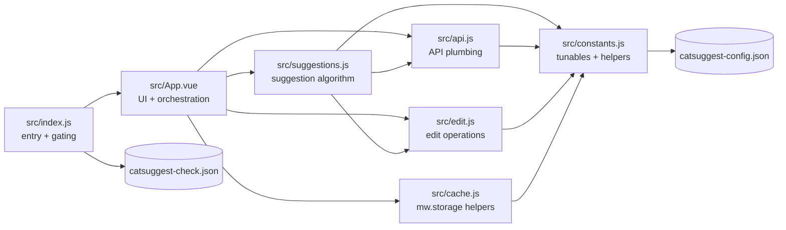

# CatSuggest — Kateqoriya təklifçisi

A [MediaWiki gadget](https://az.wikipedia.org/wiki/Vikipediya:Qadcetlər/Kateqoriya_təklifçisi)
for Azerbaijani Wikipedia that suggests categories to add to pages — and categories to
remove — based on interwiki sitelinks and Wikidata.

The gadget reads the same article's page on other Wikipedias, translates the categories
it finds back to Azerbaijani via langlinks, filters out anything redundant or harmful,
and lets the user apply the result in a single dialog.

## How it works

The gadget appears as a button below the category box on articles and category pages
(namespaces: main, project, help, category, portal). It requires a logged-in user and a
page linked to Wikidata. There are two modes:

* **Parent categories** (`Kateqoriya təklifləri`, available on every allowed page):
  collects the categories of the same article on selected foreign Wikipedias and
  suggests the ones missing on the Azerbaijani page. Categories already on the page,
  ancestors of the page's categories, and descendants of the page's own category are
  filtered out using a cycle-aware walk of the local category graph. Redundant
  categories already on the page (ones that have descendants also on the page) are
  offered for removal, with a tree showing why.
* **Members** (`Məqalə və altkateqoriya`, category pages, restricted to sysops,
  interface-admins and [allowlisted users](#configuration)): suggests articles and
  subcategories to add to the current category, based on the members of the same-named
  category on foreign Wikipedias. Pages that are already members, or that live inside
  an existing subcategory, are excluded.

Both modes cache aggressively in `mw.storage` (foreign results, local member trees,
site metadata, language preferences) and warn when a suggestion came from a redirect
on a foreign wiki, showing the original title in a tooltip.



## Dialog lifecycle

Batch edits can be stopped midway, and failures are reported per page. The confirm
button is only enabled after the results have been scrolled to the end.



## Architecture

The gadget is a single esbuild bundle that runs inside MediaWiki. Vue and Codex are
provided by `mw.loader` at runtime, and in production the JSON config files are served
by MediaWiki's gadget packaging system rather than being bundled.



| Path                                 | Role                                                                                     |
| ------------------------------------ | ---------------------------------------------------------------------------------------- |
| `src/index.js`                       | Entry point: loads modules, gates on namespace, action, redirect, login and rights; mounts the app |
| `src/App.vue`                        | The whole UI (Wikimedia Codex components) and the fetch/edit orchestration                |
| `src/suggestions.js`                 | Core algorithm: foreign data collection, category-graph filtering, removal detection      |
| `src/api.js`                         | Retries with backoff, GET→POST escalation for long queries, continuation merging, batch sizing |
| `src/edit.js`                        | Edit operations, duplicate-category precheck, template-added category detection           |
| `src/cache.js`                       | `mw.storage` helpers: processed pages, site metadata, member trees                        |
| `src/constants.js`                   | Tunables, cache keys, Azerbaijani plural-aware title helpers, config loader               |
| `src/catsuggest-config.json`         | Exclusion rules (sites, keywords, titles) and the large-wiki list                         |
| `src/catsuggest-check.json`          | User allowlist for the members tab                                                        |
| `catsuggest.css`                     | Gadget styles, built on Codex CSS variables                                               |
| `build.js`                           | esbuild build with a hand-rolled Vue SFC plugin                                           |
| `bin/deploy.js`                      | Deploys the bundle and CSS to azwiki with `mwn`                                           |
| `bin/server.js`                      | Static file server for local development                                                  |
| `bin/cattree.js`, `bin/members.js`   | Read-only Node diagnostics that run the suggestion pipeline against the live wikis        |
| `tests/`                             | Vitest suites for the api, cache, constants, edit and suggestions modules                 |

## Development

* `npm install` to install dependencies
* `npm run lint` to run ESLint
* `npm run build` to build the compiled bundle to `dist/catsuggest.js`

While developing, you can load the compiled JavaScript served from your local machine.
To do this, add the following to your [common.js](https://az.wikipedia.org/wiki/Special:MyPage/common.js):

```js
mw.loader.load( 'http://localhost:5500/catsuggest.css', 'text/css' );
mw.loader.load( 'http://localhost:5500/dist/catsuggest.js' );
```

The CSS is in the project root, and the compiled JS is in `dist/`.

Then start the development server:

```sh
npm run serve
```

By default the server runs on port 5500. To use a different port:

```sh
node bin/server.js 5501
```

### Commands

| Command                 | Description                                                    |
| ----------------------- | -------------------------------------------------------------- |
| `npm run build`         | Development build (unminified) to `dist/catsuggest.js`          |
| `npm run build:prod`    | Minified production build                                       |
| `npm run dev`           | Watch build + auto-restarting dev server                        |
| `npm run serve`         | Serve `dist/` and the CSS on `http://localhost:5500`            |
| `npm run test`          | ESLint + Prettier check + unit tests                            |
| `npm run test:unit`     | Vitest only                                                     |
| `npm run lint`          | ESLint over `src/`                                              |
| `npm run format`        | Prettier over `src/`, `bin/` and the CSS                        |
| `npm run deploy`        | Test, production build, then publish to azwiki                  |

## Configuration

* `src/catsuggest-config.json` — behaviour without code changes:
  * `excludedSites` — wikis never queried (Commons, Wikidata, Meta, …)
  * `excludedTitleKeywords` / `excludedKeywordAllowPatterns` — categories with these
    keywords (birth-year, membership, draft, maintenance, …) are never suggested or
    removed, unless the title matches an allow pattern
  * `excludedTitles` — hard-excluded category titles
  * `removalExcludedKeywords` — keywords that block redundancy-based removals
  * `largeWikiSites` — wikis shown in the default "Əsas vikilər" tab
* `src/catsuggest-check.json` — `enabledusers` allowlist granting access to the
  members tab
* `src/constants.js` — all tunables (batch sizes, cache TTLs, retry policy, ancestor
  walk depth). **`DEV_MODE` and `DEBUG` must be turned off before deploying** — the
  deploy script refuses to run while `DEV_MODE` is enabled.

## Deployment

You must have `interface-admin` rights to deploy.
Visit https://az.wikipedia.org/wiki/Special:BotPasswords to obtain credentials,
then copy `credentials.json.dist` to `credentials.json` and fill in the details:

```json
{
   "username": "YourUsername@botsuffic",
   "password": "your-bot-password"
}
```

Make sure the dist files are up to date:

```sh
npm run build
```

To deploy, run:

```sh
npm run deploy "[edit summary]"
```

The edit summary is prefixed with a link to the deployed git commit, e.g.
`[[gitlab:nmw03/catsuggest/-/commit/<sha>|<short sha>]]: [edit summary]`.

If no edit summary is provided, the latest commit message is used.

## Source

https://gitlab.wikimedia.org/NMW03/catsuggest

## License

MIT — see [LICENSE](LICENSE).
